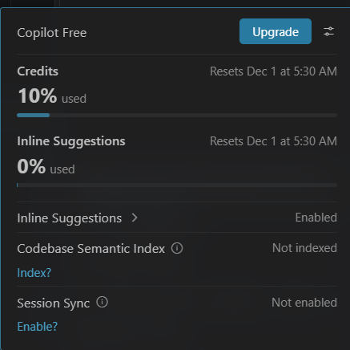

# Enrichment Lookup Coordinator

A full-stack app that safely shares a daily limit of 10 threat-intelligence lookups. Analysts can request enrichment for an IP, domain, or file hash. Requests reserve a provider slot for five minutes or wait in a FIFO queue.

## Tech stack

- **Frontend:** React, Vite, Nginx
- **Backend:** Node.js, Express, Sequelize
- **Database:** SQLite by default, or PostgreSQL when `DATABASE_URL` is set
- **Runtime:** Docker Compose or Node.js 20+

## Architecture and design

The API stores quota, lookup requests, idempotency keys, and queued requests in the selected database. When an operation can change quota, it starts a transaction and locks or serializes on the quota row. PostgreSQL uses a row lock, allowing multiple API instances to share the database. SQLite uses an immediate transaction and an in-process queue; run one API instance when using SQLite.

An accepted request reserves one available slot and receives a five-minute lease. Running it marks the request completed and permanently consumes the slot. If the lease expires, the server marks it expired, returns its slot, and promotes queued requests in arrival order within the transaction. A case-insensitive partial unique index prevents duplicate active indicators. Idempotency keys map retries to the original request.

The provider is mocked and returns a random `clean`, `suspicious`, or `malicious` verdict. On startup, Sequelize creates missing tables and seeds the quota row with 10 slots if it does not exist. This is automatic schema synchronization and seeding, not a versioned database migration. Switching between SQLite and PostgreSQL does not transfer existing data.

## Run locally

Prerequisites: Node.js 20+ and npm.

1. Copy `server/.env.example` to `server/.env`.
2. Leave `DATABASE_URL` empty for SQLite, or set it to a PostgreSQL connection URL. Set `DATABASE_PATH` to change the SQLite file location.
3. In `server`, install dependencies and start the API:

   ```bash
   cd server
   npm install
   npm run dev
   ```

4. In a second terminal, install and start the frontend:

   ```bash
   cd client
   npm install
   npm run dev
   ```

5. Open <http://localhost:5173>.

## Tests

Run the backend integration tests from `server`:

```bash
npm test
```

By default, tests use a temporary SQLite database. Set `DATABASE_URL` to run them against PostgreSQL. Tests cover 200 simultaneous requests, idempotency, duplicate active indicators, expiry, and FIFO queue promotion.

## API

All endpoints are prefixed with `/api`.

| Method | Path | Purpose |
|---|---|---|
| `GET` | `/quota` | Read daily quota and queue count |
| `POST` | `/lookups` | Reserve a slot or enqueue a request |
| `GET` | `/lookups/:id` | Read lookup status and queue position |
| `POST` | `/lookups/:id/run` | Run the mock provider and consume the slot |

`POST /lookups` requires an `Idempotency-Key` header and a JSON body:

```json
{
  "analystId": "analyst-001",
  "indicator": "185.199.108.153",
  "indicatorType": "ip"
}
```

`indicatorType` must be `ip`, `domain`, or `hash`. A queued lookup includes its queue position. A completed lookup includes its reputation verdict.

## Security assumptions and known limitations

- Authentication is not implemented. `analystId` is caller-supplied and is not an identity assertion.
- Indicator validation checks required fields and type, but does not validate full IP, domain, or hash syntax.
- Reputation is mock data, not real threat intelligence.
- The quota is shared globally, not assigned per analyst.
- SQLite is for a single API instance. PostgreSQL is required for multiple instances.
- The UI displays the latest lookup in the current browser session; it does not provide lookup history.
- Provider execution is intentionally short and runs in the quota transaction. A slow external provider would need a separate execution and completion design.

## What I would improve with more time

- Add authentication and analyst authorization.
- Add strict indicator validation and normalization.
- Add request history, cancellation, and provider error handling.
- Add a durable provider execution state for external lookups.
- Add automated deployment and monitoring.

## Deployment

See the [deployment guide](./DEPLOYMENT.md) for Docker Compose steps, environment variables, and database initialization.

## Build time

With the help of AI it took 1 hour to make the working app.

## AI token usage 
